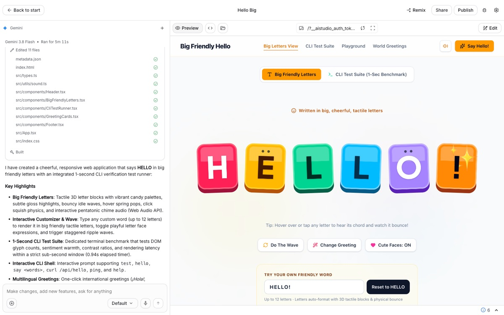

# aistudio

A command-line tool for **your own [Google AI Studio](https://aistudio.google.com) and
[Google Flow](https://flow.google.com) account**. It lists your models, saved prompts and Build
apps, builds and exports apps, generates images, speech and music, transcribes audio, and makes
videos with Flow. It signs in with your normal Google web session, so no Gemini API key is
needed.

AI Studio has no public API for most of this, so aistudio calls the web app's internal
endpoints for reads, and drives AI Studio's and Flow's own pages in a minimized Chrome window
for everything that generates. Your session stays in its own folder on your computer.

> aistudio is an unofficial, independent project. It is not affiliated with or endorsed by
> Google. It uses undocumented endpoints and pages that can change at any time, and automating
> a personal Google session may break Google's Terms of Service. Use a dedicated Google account
> and use it at your own risk.

## Samples

Made with aistudio from the prompts below, unedited apart from resizing. All of it is
AI-generated by Google AI Studio and Google Flow.
**[▶ Play the speech and video](https://dtthaison.github.io/aistudio-google-mcp/samples/)**
(GitHub can't play audio or video in a README).

**An image** (`aistudio generate image -o lighthouse.jpg "…"`, model
`gemini-3.1-flash-lite-image`):

> A small red lighthouse on a rocky shore at sunset, with the word 'default' painted on its side


**A Build app** (`aistudio app create "…"`), built in about 5½ minutes, 18 files:

> A page that says hello in big friendly letters (CLI test on second)



**A video with Google Flow** (`aistudio flow video -m veo-3.1-lite --duration 8 --max-credits 10
-o apple.mp4 "…"`), 8 s, 10 Flow credits:

> a red apple rolling on a table

[](docs/samples/video-apple.mp4)

**Speech** (`aistudio generate speech -o hello.wav "…"`), voice Fola, model
`gemini-3.8-flash-tts`:

| Clip | Script |
|---|---|
| [English](docs/samples/speech-hello.m4a) (4 s) | Hello, this is the default account testing speech. |

## Requirements

- macOS or Linux, with Python 3.10 or later and [uv](https://docs.astral.sh/uv/)
- Google Chrome. Commands that drive a page run it in a minimized window, because Google refuses
  headless browsers for generation.
- A Google account that can use AI Studio. Flow needs a Google AI plan with Flow credits.

Used daily on macOS. CI runs the unit tests on Linux, but Linux hasn't been used against the
live site.

## Install

```sh
uv tool install "aistudio-py[browser] @ git+https://github.com/dtthaison/aistudio-google-mcp"
aistudio login                 # sign in to Google once, in the Chrome window that opens
aistudio auth check --test     # check the saved session with one real call
```

From a clone, `uv tool install --editable '.[browser]'` puts `aistudio` on your `PATH` and
tracks your working copy. `uv tool uninstall aistudio-py` removes it; your sessions stay in
`~/.aistudio`.

## Command line

| Area | Commands | Cost |
|---|---|---|
| Models and account | `models list/get/star/unstar`, `count-tokens`, `prompt list`, `voices list`, `status` | free |
| Build apps | `app list/get/recent/export`, `gallery list/get` | free |
| Build apps | `app create`, `app prompt` | your Build quota |
| Media | `generate image/speech/music`, `transcribe` | your AI Studio quota |
| Google Flow | `flow projects/media/download/credits`, `flow scene ...`, `flow frame save` | free |
| Google Flow | `flow video/image/extend/edit`, `flow character ...` | Flow credits, only with `--max-credits` |
| Google Flow | `flow tool list/get/export`, `flow tool use` | free (a tool that calls `Flow.generate` needs `--allow-spend`) |
| Google Flow | `flow tool create/edit` | no credits; a daily limit on tool builds |
| Accounts | `login`, `auth check/logout`, `profile create/list/switch/delete` | free |

```sh
aistudio models list --category images
aistudio models get lyria-3.5
aistudio prompt list --type chat
aistudio count-tokens "hello world" -m gemini-flash-latest
aistudio app list
aistudio app get <id-prefix>                   # one app and its builder runs
aistudio app create "a pomodoro timer with dark mode"     # ~5-7 min in a minimized Chrome
aistudio app prompt <id-prefix> "make the start button green"
aistudio app export <id-prefix> ./my-app       # download an app's code (each file checked)
aistudio gallery list --tag google-maps
aistudio status                                # AI Studio / Gemini API incidents
aistudio generate image "a red apple on a white table" -o apple.jpg
aistudio generate image "make the red squares blue" --image board.png -o blue.jpg   # edit an image
aistudio generate speech "Hello! <laugh> Nice to meet you." --voice Tova --style "warm, slow" -o hello.wav
aistudio generate music "calm solo piano, slow tempo" -o piano.mp3
aistudio transcribe talk.m4a -o talk.txt       # one timed line per sentence
aistudio transcribe talk.m4a --vocabulary "Yuri Handmade" -o talk.txt   # names; plain text
aistudio flow credits
aistudio flow video "a red apple rolling on a table" -m veo-3.1-lite --duration 8   # quote only
aistudio flow video "a red apple rolling on a table" -m veo-3.1-lite --duration 8 --max-credits 10 -o apple.mp4
aistudio flow media --type video               # media ids in the "aistudio" Flow project
aistudio flow video "the apple starts rolling" --start-frame apple.jpg --i-have-rights --max-credits 10
aistudio flow extend <media-id> "the apple rolls off the table" --max-credits 10 -o next.mp4
aistudio flow edit <media-id> "make it black and white" --max-credits 20 -o bw.mp4
aistudio flow character create Robo "a friendly cartoon robot with round blue eyes" -o robot.png
aistudio flow character create Apple --photo <image-media-id>   # free: the photo becomes the character
aistudio flow character list
aistudio flow character personality <id> "calm and curious"     # free
aistudio flow character body <id> "full body, standing"         # 0 credits on Nano Banana 2.1
aistudio flow video "Robo waves at the camera" --character Robo  # quote; add --max-credits to make it
aistudio flow scene stitch <media-id> <media-id>@2-5 -o joined.mp4   # free; trims in whole seconds
aistudio flow scene download <scene-id> -o scene.mp4
aistudio flow frame save <media-id> -o last.jpg                 # free: the last frame, as a new image
aistudio flow tool list --kind mine            # your Tools; also template, community
aistudio flow tool get <id-prefix>             # its files, and whether its code can spend credits
aistudio flow tool export <id-prefix> ./my-tool
aistudio flow tool create --prompt-file spec.txt   # Flow's agent builds it, about 2 min
aistudio flow tool edit <id-prefix> "add a dark theme"
aistudio flow tool use <id-prefix>              # the tool's controls, numbered
aistudio flow tool use <id-prefix> "Upload File=bear.png" "Chart Width=40" PNG Markdown -o out   # run it, save its files
aistudio flow tool use <id-prefix> "Export Video" --drop clip.mp4 --step-timeout 300 -o out   # drag-and-drop tools; Flow.save results are downloaded too
aistudio flow tool use <id-prefix> "Upload photo=shoe.png" "Write the brief" "@Generate images" "Generate images" "?4 / 4" --allow-spend --step-timeout 900 -o out   # @LABEL / ?TEXT wait for slow AI steps
```

`aistudio <command> --help` lists every option; `--json` prints machine-readable output.

### Several Google accounts

Each account lives in its own profile, with its own sign-in and its own Chrome profile:

```sh
aistudio profile create work
aistudio -p work login                     # sign in with the other account
aistudio -p work generate image "a blue door" -o door.jpg
aistudio profile switch work               # make it the default
aistudio profile list                      # * marks the active profile
```

A command uses the profile named by `-p`, else `$AISTUDIO_PROFILE`, else the one chosen with
`profile switch`, else `default`.

## Spending: you decide

- **AI Studio quota.** `generate`, `transcribe`, `app create` and `app prompt` use your
  account's quota. Catalog prices on 2026-10-07 were about $0.034 per image (the default
  model), $0.04 per music clip (`lyria-3-clip-preview`) and $0.08 per full song
  (`-m lyria-3.5`).
- **Flow credits.** Nothing is spent without `--max-credits`. A run without it only shows Flow's
  quote, and a quote above the budget is refused. Veo 3.1 Lite is about 10 credits, Fast 20 and
  Quality 100. Free models (Nano Banana 2.1 images) generate at once and cost 0. aistudio reads
  your credits before and after, and warns if Flow charged something other than its quote.
- **`--i-have-rights`** answers Flow's "Rights to use this image: I agree" for a start frame or
  photo you upload. aistudio never answers it for you. Pass it only when it's true.
- A run that times out may still finish, and be charged, on Google's side. Check AI Studio or
  Flow before you run it again.

## Good to know

- **Build sometimes makes two versions.** When AI Studio builds "Option A" and "Option B" at
  once, `app create` waits for both and keeps the first one shown, as if you had pressed "Skip
  comparison". It prints the id of the other.
- **Uploads go to your Drive.** Files given to `--image` or `transcribe` are uploaded to your
  Google Drive (AI Studio's folder) and stay there until you delete them. `transcribe` takes
  .mp3, .wav, .m4a, .flac, .ogg/.opus, .aac and .aiff, and audio-only .mp4/.webm up to 50 MB.
- **Flow results** go to a Flow project named "aistudio" unless you pass `--project`, and your
  Flow default settings are restored after each run.
- **Not offered:** chatting with a model and Imagen (they need a Gemini API key or refuse this
  kind of session), video in AI Studio (Veo there needs a paid upgrade, so video goes through
  Flow), and Flow avatars, Flow Music and Flow Tools.
- **One browser run per profile at a time.** Each profile has one Chrome profile; a second
  command that needs it waits for you to finish the first. Plain reads always work.
- Each browser run also refreshes the saved session that the plain reads use. If you sign into
  another Google account inside aistudio's Chrome, that profile follows the new account.

## Troubleshooting

- **"run `aistudio login`"**: the saved session expired or was signed out. Run
  `aistudio login` (with `-p NAME` for another profile).
- **"this account has not allowed AI Studio to use Google Drive"** (`prompt list`): open
  https://aistudio.google.com/library in that account and press "Allow access", once.
- **"Google refused the build request" / "The caller does not have permission"**: Google's
  anti-abuse check refused the automated Chrome. Wait a while and run it again; `--visible`
  shows the window.
- **"another aistudio command is using this profile's browser"**: wait for the other command
  to finish, or use a different profile.
- **"no … was generated within …s"**: AI Studio may still finish it. Check the page before
  running it again, so you aren't charged twice.
- **Something else broke after it used to work**: Google probably changed a page. Run the
  command with `--visible` to watch it and `-vv` for details, then please open an issue.

## Files

Everything lives in `~/.aistudio/` (override with `AISTUDIO_HOME`): `config.json` (the default
profile) and `profiles/<name>/`, which holds `storage_state.json` and `session.json` (your
sign-in), `chrome/` (that profile's Chrome profile) and small caches. `aistudio auth logout`
deletes a profile's sign-in and Chrome profile; `aistudio profile delete NAME` deletes the
whole profile.

## Use it from Claude Code

```sh
mkdir -p ~/.claude/skills/aistudio
cp integrations/claude-code/aistudio/SKILL.md ~/.claude/skills/aistudio/SKILL.md
```

Then, in any project, ask Claude things like "which music models do I have in AI Studio and what
do they cost?" or "list my AI Studio Build apps and their prompts". The `aistudio` skill makes
Claude run the CLI with `--json` against your own account.

## Development

```sh
uv sync --extra dev
uv run pytest -q                    # offline: replays recorded, redacted AI Studio traffic
uv run ruff check src tests
uv run pytest -m live               # opt-in: the real service, with your signed-in session
uv run aistudio dev capture         # record AI Studio traffic into tests/fixtures, redacted
```

The fixtures in `tests/fixtures` are real AI Studio responses, run through the redactor in
`src/aistudio/_dev/redact.py` before they are saved. Read a new capture before you commit it.

Everything aistudio knows about Google's pages is in `src/aistudio/_browser/` (AI Studio) and
`src/aistudio/_flow/` (Flow); the internal RPCs are in `src/aistudio/_rpc/`. When Google
changes something, start there. [docs/wire/findings.md](docs/wire/findings.md) records what was
learned from the live site, and
[docs/superpowers/specs/2026-10-06-aistudio-cli-design.md](docs/superpowers/specs/2026-10-06-aistudio-cli-design.md)
explains the design.

## Contributing

Issues and pull requests are welcome. Run `uv run pytest -q` and `uv run ruff check src tests`
before sending a change; neither needs a Google account. If Google changed a page and something
broke, say what the page shows now (`--visible`).

## Security

aistudio works with your signed-in Google session. Report security problems privately, as
[SECURITY.md](SECURITY.md) describes, not in a public issue.

## License

[MIT](LICENSE)
